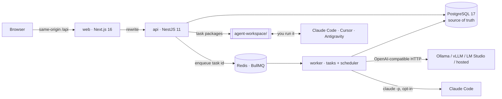

<div align="center">

# 🎯 Interview Command Center

**Self-hosted job search tracker, interview journal and AI-assisted interview preparation.**
Capture every interview, keep what you were actually asked, learn from your mistakes, and get a round-specific
crash course: with any OpenAI-compatible LLM, with your Claude Code / Cursor subscription, or with no AI at all.

[](https://github.com/azadhmhd/interview-command-center/actions/workflows/ci.yml)
[](LICENSE)


[](CONTRIBUTING.md)


> 🚧 **Still under construction.** It's in the "we'll get back to you" stage of its own hiring process: new features
> are coming, bugs are being grilled like a system design round. **Let's get hired.** 💼


</div>

---

## Why

Most interview prep is generic. The questions *you* were asked, the answers *you* gave and the concepts *you* missed
are the most valuable study material you have, and they usually end up lost in notes. Interview Command Center turns
every interview into better preparation for the next one:

**Capture → journal → find gaps → targeted plan → practice → evaluate → improve → reuse.**

## Features

- **Application tracker:** table, Kanban and timeline views, custom statuses, duplicate detection, contacts,
  documents, CV version per application, follow-up reminders, and import of a job post from its URL.
- **Interview journal:** each company gets its own sequence of rounds. Record the exact questions, your
  **original answer (locked once saved)**, missed concepts, mistakes, code, follow-ups, then improved and approved answers.
  Paste raw notes and they are split into questions automatically.
- **Personal knowledge base:** full-text search across every interview. The same question asked at two companies
  links to one entry. Spaced-repetition revision queue (SM-2).
- **Round-specific crash courses:** built from the job description, round type, deadline, your CV and your recorded
  weaknesses. Prioritised topics with reasons, a time-boxed schedule, lessons, model answers, flashcards, mock
  interviews and readiness tracking.
- **Practice & evaluation:** rubric scoring (correctness, completeness, depth, clarity). Model answers stay hidden until
  you attempt. Retry and compare with previous attempts.
- **Bring your own AI:** one OpenAI-compatible client (Ollama, vLLM, LM Studio, hosted providers) **or** your
  existing Claude Code / Cursor subscription through agent task packages and a reusable skill pack.
- **Automatic preparation schedule:** milestones at 3, 2 and 1 days before the interview and on interview day,
  quiet hours, and post-interview capture prompts.
- **Honest labels:** questions are always marked *actually asked*, *public report*, *AI prediction* or *practice*.
  CV facts stay "AI-inferred" until you confirm them.
- **Private by default:** multi-user workspaces, roles, explicit per-record sharing, audit log, export and account deletion.
- **Works offline:** with no AI configured, tracking, journaling, search, revision, scheduling, deterministic plans
  and self-evaluation all keep working.

## Screenshots

| Interview journal | Preparation course |
|---|---|
|  |  |
| **Lesson with practice** | **Applications (Kanban)** |
|  |  |
| **Agent task queue** | **AI configuration** |
|  |  |

## Architecture



A modular monolith with three processes from one codebase. Every task lives in PostgreSQL, so restarts and Redis
loss are recoverable. Details: [docs/ARCHITECTURE.md](docs/ARCHITECTURE.md).

## Quick start

### Docker (everything)

Requirements: Docker.

```bash
git clone https://github.com/azadhmhd/interview-command-center.git
cd interview-command-center
cp .env.example .env
# set APP_ENCRYPTION_KEY in .env; generate one with:
node -e "console.log(require('crypto').randomBytes(32).toString('base64'))"
docker compose up -d --build
```

Open **http://localhost:3000** and create an account. This starts PostgreSQL, Redis, API, worker and web, each
waiting for its dependencies to be healthy. Migrations run automatically.

### Local development

Requirements: Node 22, pnpm 10, Docker (for the databases).

```bash
cp .env.example .env            # set APP_ENCRYPTION_KEY
pnpm install
pnpm infra:up                   # PostgreSQL :5434 and Redis :6380
pnpm db:migrate
pnpm db:seed                    # optional demo account with fictional data
pnpm agent:install              # installs the agent skill pack into agent-workspace/
pnpm dev:api                    # terminal 1 → http://localhost:4000 (OpenAPI: /api/docs)
pnpm dev:worker                 # terminal 2 → scheduler + background tasks
pnpm dev:web                    # terminal 3 → http://localhost:3000
```

The demo account's email and password are the `SEED_DEMO_*` values in `.env.example`.
Docker's web container and `pnpm dev:web` both use port 3000, so run one at a time.

## AI setup

AI is optional, and you can combine the options below. Each AI job becomes a **task**, and the app routes it
automatically ([how routing works](docs/AGENTS.md#task-states)):

| You have | What happens |
|---|---|
| Nothing configured | Tasks wait in the **Agent task queue** for you to run them with a coding agent (Option 2/3), or you self-assess. |
| An LLM endpoint (Option 1) | Tasks run on it automatically. Research tasks still go to an agent because they need web access. |
| Claude Code automatic mode (Option 2B/2C) | Tasks the LLM can't take run through Claude Code automatically. |

Results are applied and tasks complete automatically. To approve each result first, turn on
*Workspace & members → "Ask me to approve AI and agent results"*.

### Option 1: an OpenAI-compatible LLM (Ollama, vLLM, LM Studio, hosted)

**In the app:** *Settings → AI configuration* → pick a preset or enter the base URL, model and API key →
**Test connection** → **Save**. For endpoints outside your machine or network, tick the consent box that allows
sending interview data.

**Or in `.env`:**

```env
LLM_ENABLED=true
LLM_BASE_URL=http://localhost:11434/v1     # Ollama; from Docker use http://host.docker.internal:11434/v1
LLM_MODEL=llama3.1:8b
LLM_API_KEY=                               # empty for local servers
```

Example with Ollama: `ollama pull llama3.1:8b`, then restart the API and worker
(`docker compose up -d` or re-run `pnpm dev:*`). More: [docs/AI_CONFIG.md](docs/AI_CONFIG.md).

### Option 2: Claude Code (uses your Claude subscription)

Install [Claude Code](https://docs.claude.com/en/docs/claude-code) and sign in once (`claude`). Then choose one of these:

#### 2A. Manual: you run each task (works everywhere, no `.env` changes)

1. Install the skills once: `pnpm agent:install` (copies them into `agent-workspace/.claude/skills/`).
   With Docker this happens automatically when the worker starts.
2. In the app open **Agent task queue** → a task → **Export task package**. It appears in
   `agent-workspace/tasks/<taskId>/`.
3. Run Claude Code in the agent workspace:
   ```bash
   cd agent-workspace
   claude
   ```
   and ask: `Run the ICC task in tasks/<taskId> using its skill, and write output/result.json`
4. Back in the app, click **Sync output**. The JSON is validated before anything is imported.

#### 2B. Automatic, local development (`pnpm dev:*`)

Add to `.env`, then restart `pnpm dev:api` **and** `pnpm dev:worker` (the API routes tasks, the worker runs them):

```env
AGENT_CLAUDE_CLI_ENABLED=true
AGENT_CLAUDE_CLI_PATH=claude        # or the full path from `which claude`
```

The worker runs `claude -p` in `agent-workspace/` using your existing login.

#### 2C. Automatic, Docker

The Docker image already includes the Claude Code CLI. Give the worker a long-lived token:

1. On your machine, run `claude setup-token` and copy the token it prints.
2. Add to `.env`:
   ```env
   AGENT_CLAUDE_CLI_ENABLED=true
   CLAUDE_CODE_OAUTH_TOKEN=<token from step 1>
   ```
3. `docker compose up -d --build`
4. Check: **Agent task queue** shows **Claude Code headless: Enabled**. Waiting tasks: open one → **Retry (auto-route)**.

Every automatic run counts against your Claude plan's usage, and long jobs such as course generation can take a few
minutes. The CLI only gets file tools inside `agent-workspace/` (plus web search for research tasks), no MCP servers,
and none of the app's secrets. Only the worker container receives the token; keep `.env` private.

### Option 3: Cursor (manual)

1. `pnpm agent:install` writes Cursor rules to `agent-workspace/.cursor/rules/icc-*.mdc` (automatic with Docker).
2. In the app: **Agent task queue** → task → **Export task package**.
3. In Cursor: **File → Open Folder… → `agent-workspace`**. Open the Agent chat (`Cmd/Ctrl + I`) and ask:
   `Run the ICC task in tasks/<taskId>: read TASK.md and task.json, follow the matching icc rule, and write output/result.json`
4. Back in the app, click **Sync output**.

Antigravity and other agents work the same way through `agent-workspace/AGENTS.md`. Cursor and Antigravity have no
automatic mode yet; see [docs/KNOWN_LIMITATIONS.md](docs/KNOWN_LIMITATIONS.md).

## Tech stack

| Layer | Tech |
|---|---|
| Web | Next.js 16 (App Router), React 19, TypeScript (strict), Tailwind CSS 4, shadcn/ui-style components, SWR, React Hook Form + Zod, Framer Motion |
| API | NestJS 11, Prisma 6, Zod validation → generated OpenAPI, cookie sessions (scrypt), AES-256-GCM secret storage |
| Jobs | PostgreSQL task state machine, BullMQ on Redis, leases, exponential backoff, crash recovery |
| AI | `openai` SDK against any OpenAI-compatible endpoint, Claude Code headless adapter, agent skill pack with JSON Schemas |
| Data | PostgreSQL 17 (full-text search, generated `tsvector` columns), Redis 7 |
| Ops | One multi-target Dockerfile, Docker Compose, GitHub Actions (CI, CodeQL, Dependabot) |
| Tests | Jest (unit + API e2e against real Postgres/Redis), Playwright |

## Testing

```bash
pnpm lint          # strict TypeScript, both apps
pnpm test:unit     # state machine, routing, planner, SM-2, scheduling, SSRF guard
pnpm test:e2e      # API acceptance suite (needs `pnpm infra:up`): fake OpenAI-compatible server, stub Claude CLI, two-user isolation
pnpm test:ui       # Playwright core flow against a running stack
```

See [docs/TESTING.md](docs/TESTING.md).

## Documentation

| Topic | |
|---|---|
| Architecture & decisions | [docs/ARCHITECTURE.md](docs/ARCHITECTURE.md) |
| Setup, deployment & operations | [docs/SETUP.md](docs/SETUP.md) |
| LLM configuration & troubleshooting | [docs/AI_CONFIG.md](docs/AI_CONFIG.md) |
| Coding agents, task states & skill pack | [docs/AGENTS.md](docs/AGENTS.md) |
| API overview (live OpenAPI at `/api/docs`) | [docs/API.md](docs/API.md) |
| Security design | [docs/SECURITY.md](docs/SECURITY.md) |
| Backup & recovery | [docs/BACKUP.md](docs/BACKUP.md) |
| Testing | [docs/TESTING.md](docs/TESTING.md) |
| Known limitations & roadmap | [docs/KNOWN_LIMITATIONS.md](docs/KNOWN_LIMITATIONS.md) |
| Acceptance checklist | [docs/PROGRESS.md](docs/PROGRESS.md) |

## Project structure

```
apps/
  api/              NestJS API + worker: auth, workspaces, applications, rounds, knowledge base,
                    courses, practice, LLM client, task queue, scheduler, agent adapters (Prisma schema in prisma/)
  web/              Next.js UI (src/app routes, src/components, e2e/ Playwright tests, scripts/screenshots.mjs)
skills/             Agent skill pack sources, generated JSON Schemas, templates, installer
agent-workspace/    Folder you open in Claude Code / Cursor; task packages land in tasks/
docs/               Documentation and screenshots
Dockerfile          One image definition: `api` target (API + worker) and `web` target
docker-compose.yml  PostgreSQL, Redis, API, worker, web
```

## Contributing

Contributions are welcome! Read [CONTRIBUTING.md](CONTRIBUTING.md) and the [Code of Conduct](CODE_OF_CONDUCT.md).
Report vulnerabilities privately as described in [SECURITY.md](SECURITY.md).

## License

[MIT](LICENSE) © 2026 azadhmhd
