<div align="center">

# 🎯 Interview Command Center

**Self-hosted job search tracker, interview journal and AI-assisted interview preparation.**
Capture every interview, keep what you were actually asked, learn from your mistakes, and get a round-specific
crash course: with any OpenAI-compatible LLM, with your Claude Code / Cursor subscription, or with no AI at all.

[](https://github.com/azadhmhd/interview-command-center/actions/workflows/ci.yml)
[](LICENSE)


[](CONTRIBUTING.md)


> 🚧 **Still under construction.** It's in the "we'll get back to you" stage of its own hiring process: new features
> are coming, bugs are being grilled like a system design round. **Let's get hired.** 💼

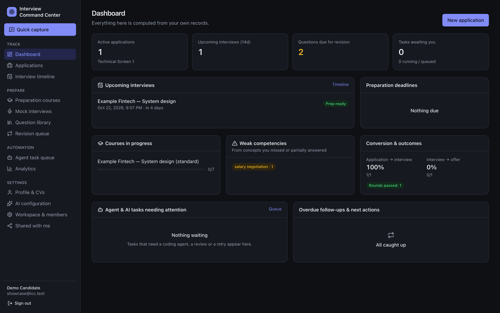

</div>

---

## Why

Most interview prep is generic. The questions *you* were asked, the answers *you* gave and the concepts *you* missed
are the most valuable study material you have, and they usually end up lost in notes. Interview Command Center turns
every interview into better preparation for the next one:

**Capture → journal → find gaps → targeted plan → practice → evaluate → improve → reuse.**

## Features

- **Application tracker:** table, Kanban and timeline views, custom statuses, duplicate detection, contacts,
  documents, CV version per application, follow-up reminders, and import of a job post from its URL.
- **Interview journal:** each company gets its own sequence of rounds. Record the exact questions, your
  **original answer (locked once saved)**, missed concepts, mistakes, code, follow-ups, then improved and approved answers.
  Paste raw notes and they are split into questions automatically.
- **Personal knowledge base:** full-text search across every interview. The same question asked at two companies
  links to one entry. Spaced-repetition revision queue (SM-2).
- **Round-specific crash courses:** built from the job description, round type, deadline, your CV and your recorded
  weaknesses. Prioritised topics with reasons, a time-boxed schedule, lessons, model answers, flashcards, mock
  interviews and readiness tracking.
- **Resume builder:** unlimited resumes and job-specific copies with the same design, a live A4 preview, PDF export and
  AI tailoring per job that may only reword and reorder (never invents facts). Files are stored in MinIO / S3 or on
  local disk. [Details](docs/RESUME_BUILDER.md)
- **Coding practice:** multi-stage problems in the style of AI-assisted coding interviews plus pattern sections, in
  Python or JavaScript. Tests run in your browser (never on the server), and an AI review scores correctness, approach,
  verification, code quality and communication. [Details](docs/CODING_PRACTICE.md)
- **Practice & evaluation:** rubric scoring (correctness, completeness, depth, clarity). Model answers stay hidden until
  you attempt. Retry and compare with previous attempts.
- **Auto Apply:** a separate section that finds jobs by your role and location through Google Jobs (SerpApi) and
  Jooble, covering LinkedIn, Indeed, Bayt, GulfTalent, Naukrigulf and company pages, plus company boards you watch
  (Greenhouse, Lever, Ashby, SmartRecruiters, Workable) and pasted alert emails. You choose which sites to apply through. It scores each job with reasons and
  hard blockers, prepares an apply kit from your saved answers, and applies through a local browser runner or Claude
  in Chrome. You can approve each job or turn on auto-submit within guardrails (stops on CAPTCHA and logins, never
  guesses answers, never applies twice, requires proof). Before applying it checks the CV's ATS keyword match and
  tailors a copy when it scores low. The runner can drive Claude Code in your own browser (Claude in Chrome), which
  works on forms that reject automated browsers. A Mission control page shows the pipeline live. Recruiter contacts
  are saved for later outreach. [Details](docs/AUTO_APPLY.md)
- **Bring your own AI:** one OpenAI-compatible client (Ollama, vLLM, LM Studio, hosted providers) **or** your
  existing Claude Code / Cursor subscription through agent task packages and a reusable skill pack.
- **Automatic preparation schedule:** milestones at 3, 2 and 1 days before the interview and on interview day,
  quiet hours, and post-interview capture prompts.
- **Honest labels:** questions are always marked *actually asked*, *public report*, *AI prediction* or *practice*.
  CV facts stay "AI-inferred" until you confirm them.
- **Private by default:** multi-user workspaces, roles, explicit per-record sharing, audit log, export and account deletion.
- **Works offline:** with no AI configured, tracking, journaling, search, revision, scheduling, deterministic plans
  and self-evaluation all keep working.

## Screenshots

All screenshots use the seeded demo account with fictional data.

| Mission control | Discover jobs (bulk approve) |
|---|---|
| 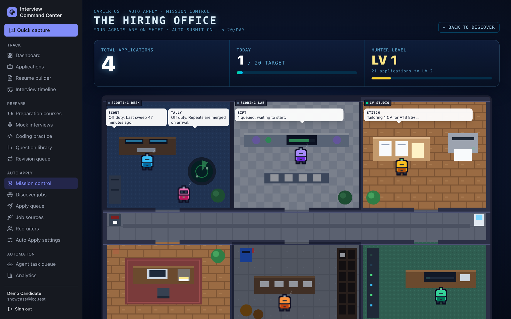 | 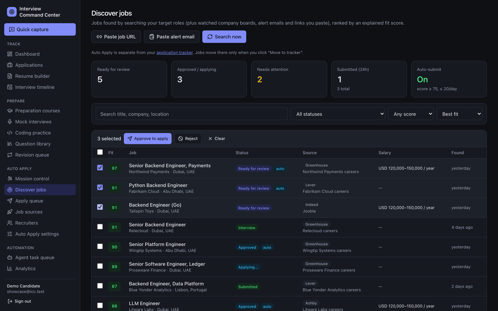 |
| **Job detail: fit score, ATS check, apply kit** | **Auto Apply settings** |
| 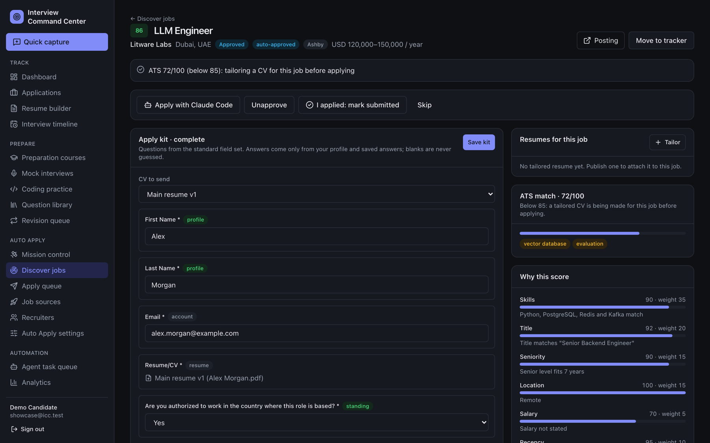 | 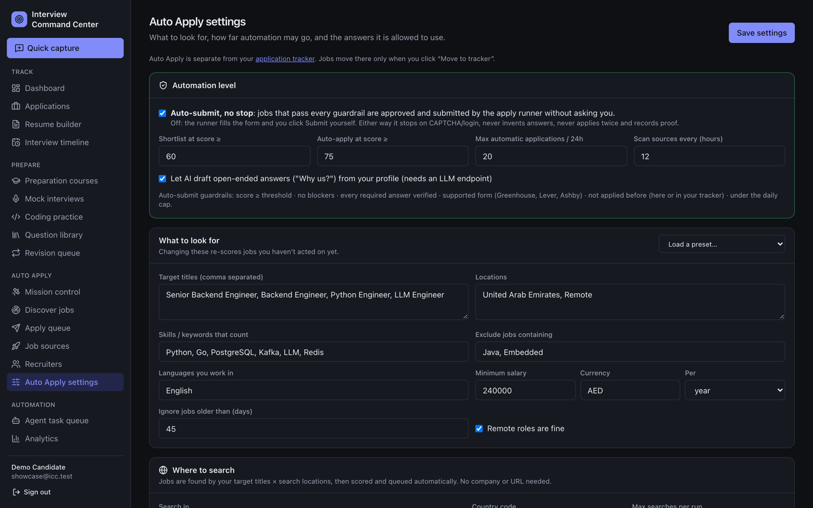 |
| **Where to search: Google Jobs and Jooble** | **Resume builder** |
| 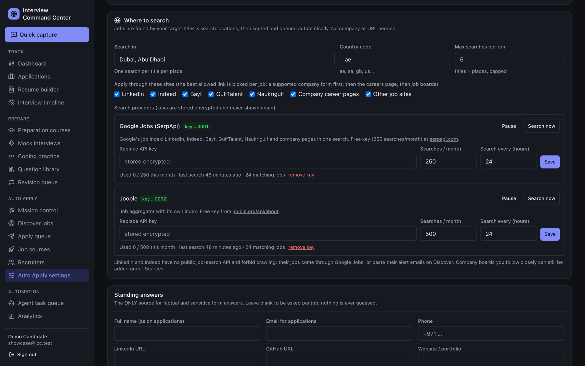 | 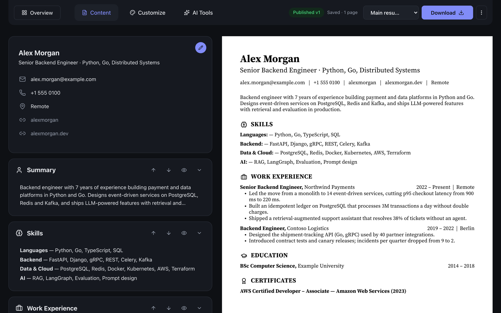 |
| **Coding practice** | **Coding sandbox** |
| 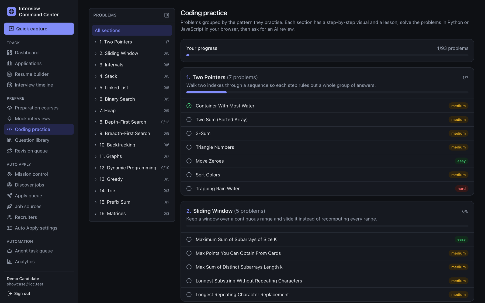 | 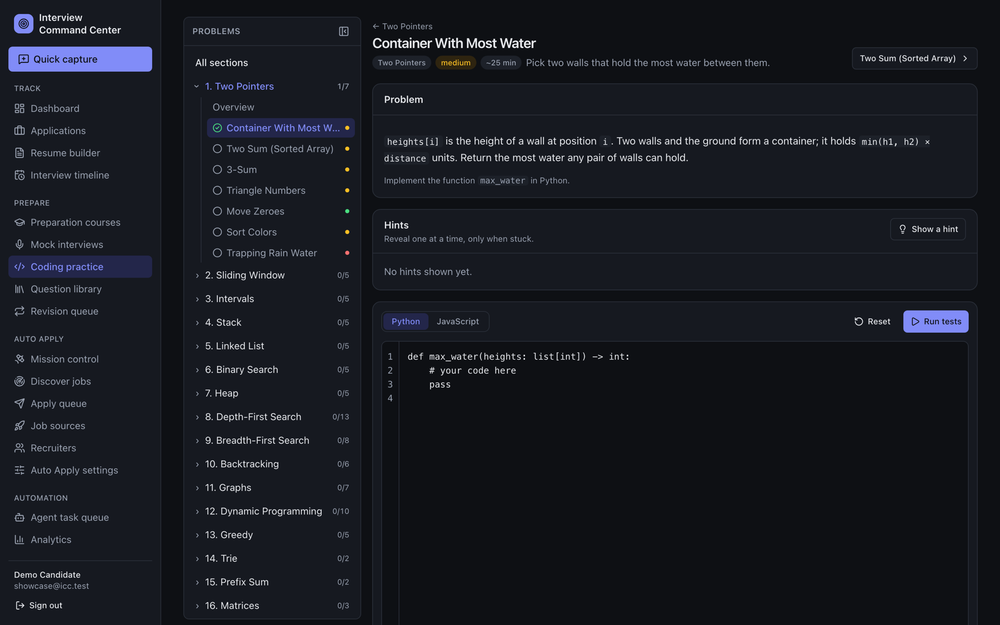 |
| **Interview journal** | **Preparation course** |
| 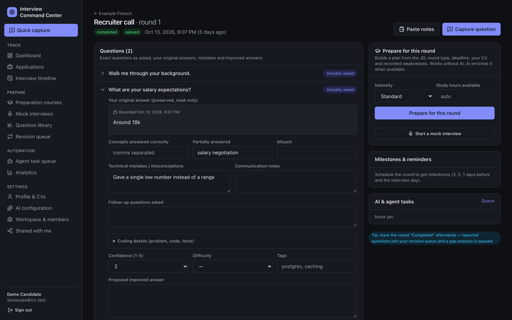 | 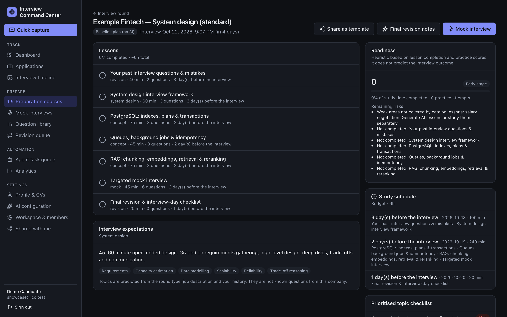 |
| **Lesson with practice** | **Applications (Kanban)** |
| 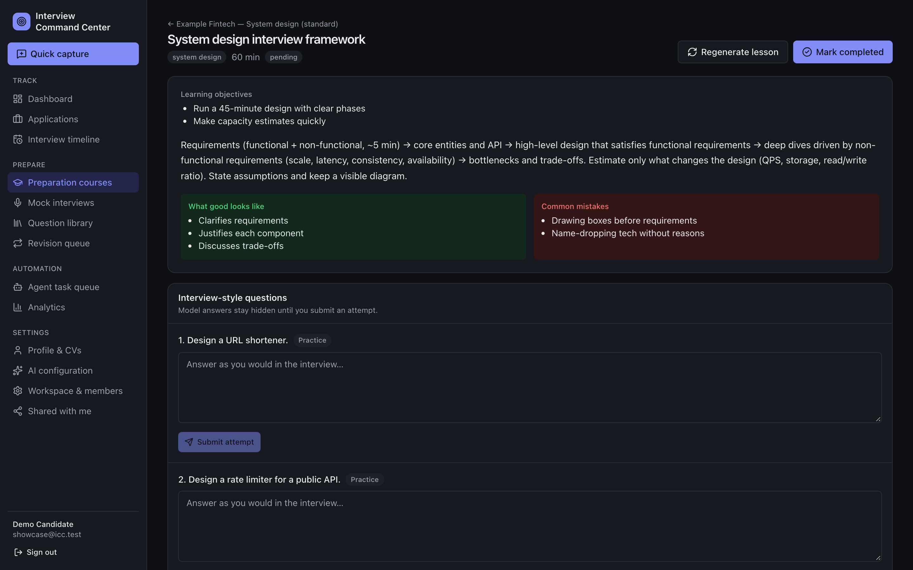 | 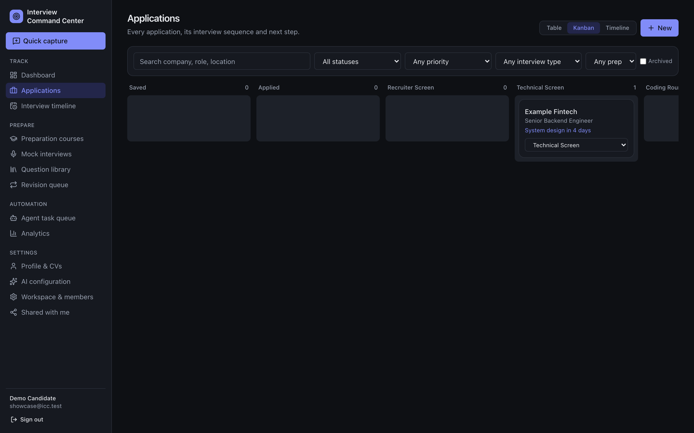 |
| **Agent task queue** | **AI configuration** |
| 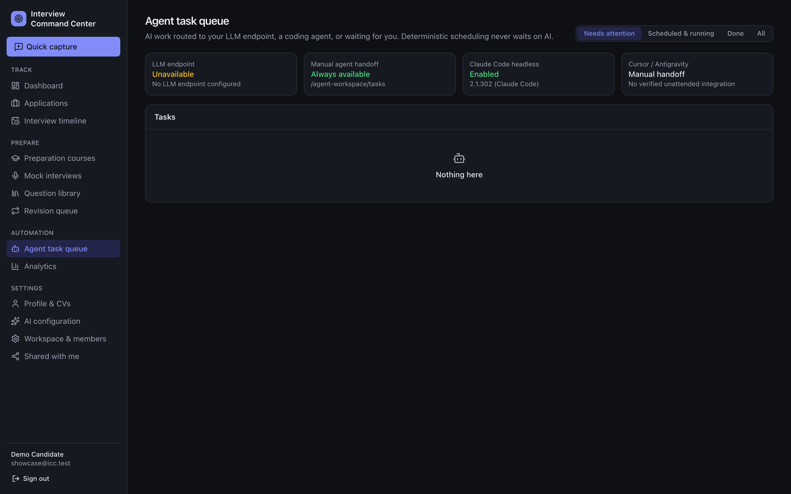 | 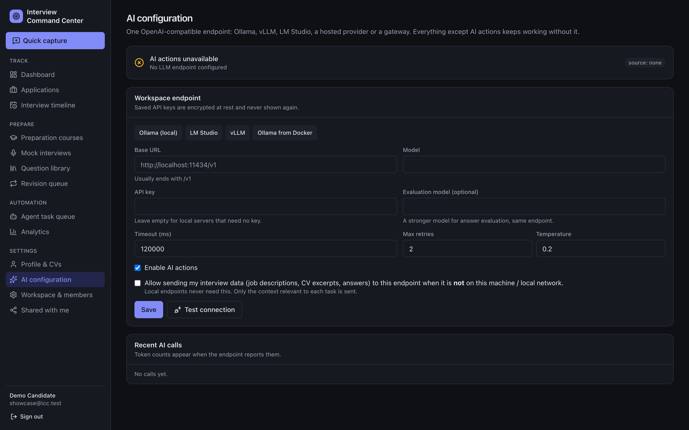 |

## Architecture

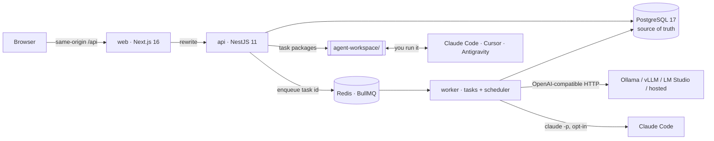

A modular monolith with three processes from one codebase. Every task lives in PostgreSQL, so restarts and Redis
loss are recoverable. Details: [docs/ARCHITECTURE.md](docs/ARCHITECTURE.md).

## Quick start

### Docker (everything)

Requirements: Docker.

```bash
git clone https://github.com/azadhmhd/interview-command-center.git
cd interview-command-center
cp .env.example .env
# set APP_ENCRYPTION_KEY in .env; generate one with:
node -e "console.log(require('crypto').randomBytes(32).toString('base64'))"
docker compose up -d --build
```

Open **http://localhost:3000** and create an account. This starts PostgreSQL, Redis, MinIO (file storage), API, worker
and web, each waiting for its dependencies to be healthy. Migrations run automatically.

Running it on a home server or VM? Put the server's address in `.env` (`APP_URL=http://<server>:3000`) and keep
`COOKIE_SECURE=false` unless you serve it over HTTPS. Backups: [docs/BACKUP.md](docs/BACKUP.md).

### Local development

Requirements: Node 22, pnpm 10, Docker (for the databases).

```bash
cp .env.example .env            # set APP_ENCRYPTION_KEY
pnpm install
pnpm infra:up                   # PostgreSQL :5434 and Redis :6380
pnpm db:migrate
pnpm db:seed                    # optional demo account with fictional data
pnpm agent:install              # installs the agent skill pack into agent-workspace/
pnpm dev:api                    # terminal 1 → http://localhost:4000 (OpenAPI: /api/docs)
pnpm dev:worker                 # terminal 2 → scheduler + background tasks
pnpm dev:web                    # terminal 3 → http://localhost:3000
```

The demo account's email and password are the `SEED_DEMO_*` values in `.env.example`.
Docker's web container and `pnpm dev:web` both use port 3000, so run one at a time.

## AI setup

AI is optional, and you can combine the options below. Each AI job becomes a **task**, and the app routes it
automatically ([how routing works](docs/AGENTS.md#task-states)):

| You have | What happens |
|---|---|
| Nothing configured | Tasks wait in the **Agent task queue** for you to run them with a coding agent (Option 2/3), or you self-assess. |
| An LLM endpoint (Option 1) | Tasks run on it automatically. Research tasks still go to an agent because they need web access. |
| Claude Code automatic mode (Option 2B/2C) | Tasks the LLM can't take run through Claude Code automatically. If the LLM fails or times out on a task, it is retried on Claude Code. |
| Claude in Chrome (Option 4) | The Auto Apply runner fills and submits job forms in your own browser. |

Which AI does what:

| Feature | Runs on |
|---|---|
| Courses, lessons, evaluation, CV facts, job match | LLM endpoint, else Claude Code |
| Company research | Claude Code (needs web search) |
| Resume tailoring and ATS-driven CV copies | LLM endpoint or Claude Code (route it under *Workspace & members → Task routing policy*) |
| Coding practice review | LLM endpoint or Claude Code |
| Filling and submitting job applications | Auto Apply runner: Claude in Chrome (recommended) or a Playwright browser |

Results are applied and tasks complete automatically. To approve each result first, turn on
*Workspace & members → "Ask me to approve AI and agent results"*.

### Option 1: an OpenAI-compatible LLM (Ollama, vLLM, LM Studio, hosted)

**In the app:** *Settings → AI configuration* → pick a preset or enter the base URL, model and API key →
**Test connection** → **Save**. For endpoints outside your machine or network, tick the consent box that allows
sending interview data.

**Or in `.env`:**

```env
LLM_ENABLED=true
LLM_BASE_URL=http://localhost:11434/v1     # Ollama; from Docker use http://host.docker.internal:11434/v1
LLM_MODEL=llama3.1:8b
LLM_API_KEY=                               # empty for local servers
```

Example with Ollama: `ollama pull llama3.1:8b`, then restart the API and worker
(`docker compose up -d` or re-run `pnpm dev:*`). More: [docs/AI_CONFIG.md](docs/AI_CONFIG.md).

### Option 2: Claude Code (uses your Claude subscription)

Install [Claude Code](https://docs.claude.com/en/docs/claude-code) and sign in once (`claude`). Then choose one of these:

#### 2A. Manual: you run each task (works everywhere, no `.env` changes)

1. Install the skills once: `pnpm agent:install` (copies them into `agent-workspace/.claude/skills/`).
   With Docker this happens automatically when the worker starts.
2. In the app open **Agent task queue** → a task → **Export task package**. It appears in
   `agent-workspace/tasks/<taskId>/`.
3. Run Claude Code in the agent workspace:
   ```bash
   cd agent-workspace
   claude
   ```
   and ask: `Run the ICC task in tasks/<taskId> using its skill, and write output/result.json`
4. Back in the app, click **Sync output**. The JSON is validated before anything is imported.

#### 2B. Automatic, local development (`pnpm dev:*`)

Add to `.env`, then restart `pnpm dev:api` **and** `pnpm dev:worker` (the API routes tasks, the worker runs them):

```env
AGENT_CLAUDE_CLI_ENABLED=true
AGENT_CLAUDE_CLI_PATH=claude        # or the full path from `which claude`
```

The worker runs `claude -p` in `agent-workspace/` using your existing login.

#### 2C. Automatic, Docker

The Docker image already includes the Claude Code CLI. Give the worker a long-lived token:

1. On your machine, run `claude setup-token` and copy the token it prints.
2. Add to `.env`:
   ```env
   AGENT_CLAUDE_CLI_ENABLED=true
   CLAUDE_CODE_OAUTH_TOKEN=<token from step 1>
   ```
3. `docker compose up -d --build`
4. Check: **Agent task queue** shows **Claude Code headless: Enabled**. Waiting tasks: open one → **Retry (auto-route)**.

Every automatic run counts against your Claude plan's usage, and long jobs such as course generation can take a few
minutes. The CLI only gets file tools inside `agent-workspace/` (plus web search for research tasks), no MCP servers,
and none of the app's secrets. Only the worker container receives the token; keep `.env` private.

### Option 3: Cursor (manual)

1. `pnpm agent:install` writes Cursor rules to `agent-workspace/.cursor/rules/icc-*.mdc` (automatic with Docker).
2. In the app: **Agent task queue** → task → **Export task package**.
3. In Cursor: **File → Open Folder… → `agent-workspace`**. Open the Agent chat (`Cmd/Ctrl + I`) and ask:
   `Run the ICC task in tasks/<taskId>: read TASK.md and task.json, follow the matching icc rule, and write output/result.json`
4. Back in the app, click **Sync output**.

Antigravity and other agents work the same way through `agent-workspace/AGENTS.md`. Cursor and Antigravity have no
automatic mode yet; see [docs/KNOWN_LIMITATIONS.md](docs/KNOWN_LIMITATIONS.md).

### Option 4: Claude in Chrome (applying to jobs in your own browser)

Job forms on Ashby and the newer Greenhouse boards silently reject automated browsers. Claude in Chrome drives your
real, signed-in Chrome or Brave instead, so those forms accept the application.

1. Install the [Claude in Chrome](https://claude.com/chrome) extension in Chrome or Brave and sign in with the same
   Claude account as Claude Code.
2. Check that Claude Code can see it: run `claude --chrome` and ask *"list my connected browsers"*. Note the
   `deviceId` of the browser (profile) you want applications to go through.
3. Use it from the Auto Apply runner ([step 7 below](#7-start-the-apply-runner)).

## Auto Apply setup

Auto Apply finds jobs for your target roles, scores each one with reasons, prepares an apply kit from answers you
saved, checks your CV's ATS match and applies. Set it up once, in this order. Full reference:
[docs/AUTO_APPLY.md](docs/AUTO_APPLY.md).

### 1. Profile and CV

- **Profile & CVs:** upload your CV. Extracted facts stay "AI-inferred" until you confirm them.
- **Resume builder:** create your main resume (or import the uploaded CV) and click **Publish**. The published PDF is
  the CV the apply kit attaches, and the ATS check tailors copies of it.

### 2. What to look for

*Auto Apply settings → What to look for* (or **Load a preset…** and edit it):

- **Target titles**, **Locations** ("United Arab Emirates" or "UAE" also matches every emirate: Dubai, Abu Dhabi,
  Sharjah, Ajman…), **Skills / keywords**, **Exclude jobs containing**, languages, minimum salary, maximum age, and
  whether remote roles are fine.
- Changing these re-scores every job you haven't acted on yet.

### 3. Where to search (no company names or URLs needed)

*Auto Apply settings → Where to search:*

- **Search in:** the cities to search, plus a **Country code** (`ae`, `sa`, `gb`, `us`, …). One search runs per title
  per place, capped by **Max searches per run**.
- **Apply through these sites:** LinkedIn, Indeed, Bayt, GulfTalent, Naukrigulf, company career pages, other boards.
  For each job the best allowed link wins: a supported company form first, then the careers page, then job boards.
- **Search providers:** paste a key and click **Save**. Keys are encrypted with `APP_ENCRYPTION_KEY` and never shown again.

| Provider | Covers | Key |
|---|---|---|
| Google Jobs (SerpApi) | Google's job index: LinkedIn, Indeed, Bayt, GulfTalent, Naukrigulf, Glassdoor and company pages | Free plan with 250 searches a month at [serpapi.com](https://serpapi.com) |
| Jooble | Jooble's own index, which includes many Indeed listings | Free key from [jooble.org/api/about](https://jooble.org/api/about) |

Each provider has a monthly budget and a schedule (default every 24 h). **Search now** runs one immediately.


### 4. Company boards and alert emails (optional)

- **Job sources:** watch a company's Greenhouse, Lever, Ashby, SmartRecruiters or Workable board by its board name
  (from the company's careers link). New openings arrive on every scan.
- **Discover jobs → Paste alert email / Paste job URL:** LinkedIn and Indeed alert emails and single job links are
  recognised too.

### 5. Standing answers

*Auto Apply settings → Standing answers* is the **only** source for factual and sensitive answers: name, email, phone,
links, work authorisation, notice period, salary expectation, demographics. Leave a field blank to be asked per job.
Nothing is ever guessed. Tick **Let AI draft open-ended answers** to allow "Why us?" style answers from your profile
(needs an LLM endpoint or Claude Code).

### 6. Automation level

*Auto Apply settings → Automation level:*

- **Auto-submit, no stop** off (default): you approve jobs on **Discover jobs** (one at a time, or tick several and use
  **Approve to apply / Reject**), and the runner fills the form for you to submit.
- **Auto-submit** on: a job is approved and submitted without asking only if its score is at or above **Auto-apply at
  score**, it has no blockers, every required answer is verified, the form is supported, it hasn't been applied to
  before (here or in your tracker) and you're under **Max automatic applications / 24h**.
- In every mode the runner stops on CAPTCHA, login or OTP, never guesses a required answer, never applies twice and
  only marks a job submitted when it saw a confirmation.

**ATS check:** before an approved job is applied to, your CV is scored against the job description. Below **85/100** a
copy of your main resume is tailored to the job (it may only reword and reorder, never invent), published, re-scored
and attached. This needs an LLM endpoint or Claude Code automatic mode (Option 1 or 2B/2C).

### 7. Start the apply runner

The runner claims approved jobs from the server, applies and reports evidence back. Create a token under
*Auto Apply settings → Runner tokens → Create runner token* (it is shown once), then pick one:

**A. Claude engine on your computer (recommended):** needs Claude Code signed in and Claude in Chrome connected
([Option 4](#option-4-claude-in-chrome-applying-to-jobs-in-your-own-browser)).

```bash
pnpm install
ICC_API_URL=http://localhost:3000 \
ICC_RUNNER_TOKEN=<token> \
APPLY_RUNNER_ENGINE=claude \
APPLY_RUNNER_BROWSER_ID=<deviceId> \
pnpm apply:runner
```

`APPLY_RUNNER_BROWSER_ID` is only needed when more than one browser is connected. Point `ICC_API_URL` at your server if
the app runs elsewhere. The runner also picks up jobs you send with **Apply with Claude Code**. Keep the computer
awake and the browser open while it runs.

**B. Playwright engine on your computer:** a separate, isolated Chromium profile (never your everyday browser).

```bash
pnpm install && pnpm --filter apply-runner exec playwright install chromium
ICC_API_URL=http://localhost:3000 ICC_RUNNER_TOKEN=<token> pnpm apply:runner
```

**C. Headless on the server (Docker):** add to `.env`, then `docker compose up -d --build apply-runner`.

```env
COMPOSE_PROFILES=runner
ICC_RUNNER_TOKEN=<token>
```

Headless is meant for auto-submit mode, and forms protected by invisible reCAPTCHA (Ashby, new Greenhouse boards) end
in *Blocked* with a screenshot of the filled form. Use option A for those.

Runner options: `APPLY_RUNNER_HEADLESS`, `APPLY_RUNNER_ONCE`, `APPLY_RUNNER_POLL_MS`, `APPLY_RUNNER_REVIEW_MINUTES`,
`APPLY_RUNNER_PROFILE` ([details](docs/AUTO_APPLY.md#the-apply-runner-your-machine)).

### 8. Watch it work

- **Mission control:** a live office where each agent (scouting, scoring, CV tailoring, applying…) shows what it is
  doing, with today's count against your daily cap and your total applications.
- **Apply queue:** approved, applying and submitted jobs with attempts, screenshots and confirmations.
- **Needs attention:** jobs that hit a CAPTCHA, a login or an unknown required question. Open one, fix the kit or apply
  yourself, then **I applied: mark submitted**.
- **Move to tracker** copies a job into your application tracker once you hear back.

## Resume builder

Create resumes under **Resume builder**: edit sections on the left with a live A4 preview on the right, change
template, fonts and colours under **Customize**, and tailor to a job under **AI Tools**. **Download** exports a PDF.

- **PDF export:** with Docker it works out of the box. For local development run
  `pnpm --filter api exec playwright install --only-shell chromium` once (`PDF_ENABLED`, `WEB_INTERNAL_URL` in `.env`).
- **File storage:** Docker Compose starts MinIO and stores CVs, generated PDFs and attachments there. Use any
  S3-compatible bucket by setting `S3_ENDPOINT`, `S3_BUCKET`, `S3_ACCESS_KEY` and `S3_SECRET_KEY`; leave `S3_ENDPOINT`
  empty to keep files in `UPLOAD_DIR`. Change the default MinIO keys before exposing the server.

Details: [docs/RESUME_BUILDER.md](docs/RESUME_BUILDER.md).

## Coding practice

**Coding practice** has 93 original problems in 16 pattern sections (two pointers, sliding window, graphs, dynamic
programming…), each with a lesson and a step-by-step visual. Pick Python or JavaScript, write your solution and click
**Run tests**: the code runs in your browser (Python through Pyodide), never on the server. Passing every test marks the
problem done. Click **Get AI review** for a review that scores correctness, approach, verification, code
quality and communication; it runs on your LLM endpoint or Claude Code. Details:
[docs/CODING_PRACTICE.md](docs/CODING_PRACTICE.md).

## Tech stack

| Layer | Tech |
|---|---|
| Web | Next.js 16 (App Router), React 19, TypeScript (strict), Tailwind CSS 4, shadcn/ui-style components, SWR, React Hook Form + Zod, Framer Motion |
| API | NestJS 11, Prisma 6, Zod validation → generated OpenAPI, cookie sessions (scrypt), AES-256-GCM secret storage |
| Jobs | PostgreSQL task state machine, BullMQ on Redis, leases, exponential backoff, crash recovery |
| AI | `openai` SDK against any OpenAI-compatible endpoint, Claude Code headless adapter, agent skill pack with JSON Schemas |
| Data | PostgreSQL 17 (full-text search, generated `tsvector` columns), Redis 7 |
| Ops | One multi-target Dockerfile, Docker Compose, GitHub Actions (CI, CodeQL, Dependabot) |
| Tests | Jest (unit + API e2e against real Postgres/Redis), Playwright |

## Testing

```bash
pnpm lint          # strict TypeScript, both apps
pnpm test:unit     # state machine, routing, planner, SM-2, scheduling, SSRF guard
pnpm test:e2e      # API acceptance suite (needs `pnpm infra:up`): fake OpenAI-compatible server, stub Claude CLI, two-user isolation
pnpm test:ui       # Playwright core flow against a running stack
pnpm test:runner   # Auto Apply runner against local mock application forms
```

See [docs/TESTING.md](docs/TESTING.md).

## Documentation

| Topic | |
|---|---|
| Architecture & decisions | [docs/ARCHITECTURE.md](docs/ARCHITECTURE.md) |
| Setup, deployment & operations | [docs/SETUP.md](docs/SETUP.md) |
| LLM configuration & troubleshooting | [docs/AI_CONFIG.md](docs/AI_CONFIG.md) |
| Resume builder: templates, job copies, PDF, tailoring, storage | [docs/RESUME_BUILDER.md](docs/RESUME_BUILDER.md) |
| Auto Apply: sources, matching, guardrails, runner | [docs/AUTO_APPLY.md](docs/AUTO_APPLY.md) |
| Coding practice: 93 problems in 16 sections, pattern lessons, in-browser runner, AI review | [docs/CODING_PRACTICE.md](docs/CODING_PRACTICE.md) |
| Coding agents, task states & skill pack | [docs/AGENTS.md](docs/AGENTS.md) |
| API overview (live OpenAPI at `/api/docs`) | [docs/API.md](docs/API.md) |
| Security design | [docs/SECURITY.md](docs/SECURITY.md) |
| Backup & recovery | [docs/BACKUP.md](docs/BACKUP.md) |
| Testing | [docs/TESTING.md](docs/TESTING.md) |
| Known limitations & roadmap | [docs/KNOWN_LIMITATIONS.md](docs/KNOWN_LIMITATIONS.md) |
| Acceptance checklist | [docs/PROGRESS.md](docs/PROGRESS.md) |

## Project structure

```
apps/
  api/              NestJS API + worker: auth, workspaces, applications, rounds, knowledge base,
                    courses, practice, LLM client, task queue, scheduler, agent adapters (Prisma schema in prisma/)
  web/              Next.js UI (src/app routes, src/components, e2e/ Playwright tests, scripts/screenshots.mjs)
  apply-runner/     Auto Apply runner: applies to approved jobs through Claude in Chrome or an isolated Playwright browser
skills/             Agent skill pack sources, generated JSON Schemas, templates, installer
agent-workspace/    Folder you open in Claude Code / Cursor; task packages land in tasks/
docs/               Documentation and screenshots
Dockerfile          One image definition: `api` (API + worker), `web` and `runner` targets
docker-compose.yml  PostgreSQL, Redis, MinIO, API, worker, web, optional apply-runner
```

## Contributing

Contributions are welcome! Read [CONTRIBUTING.md](CONTRIBUTING.md) and the [Code of Conduct](CODE_OF_CONDUCT.md).
Report vulnerabilities privately as described in [SECURITY.md](SECURITY.md).

## License

[MIT](LICENSE) © 2026 azadhmhd
